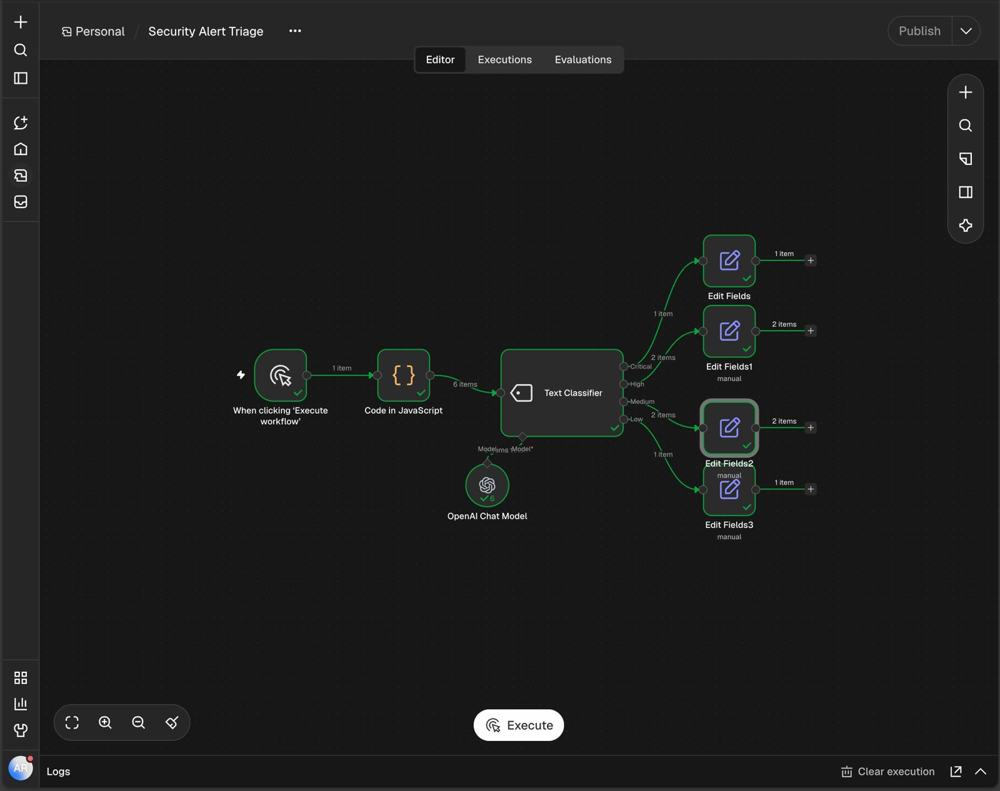

# n8n Security Alert Triage

An n8n workflow that uses an LLM to sort incoming security alerts by severity and route each one to a response action.

## How it works

1. **Trigger**: started manually (for testing)
2. **Sample alerts**: a Code node creates 6 realistic alerts (EDR, IAM, WAF, SIEM, vulnerability scanner, email gateway)
3. **Text Classifier**: an LLM (OpenAI gpt-4o-mini) assigns each alert to a category, based on written category definitions
4. **Routing**: each category branch attaches a response action

| Severity | Definition (summary) | Action |
|---|---|---|
| Critical | Active compromise or ongoing damage | Isolate host and page on-call now |
| High | Signs the attacker may have succeeded; not fully blocked attacks | Open incident ticket, review within 1 hour |
| Medium | Blocked/failed attack attempts, or an exploitable vulnerability | Add to daily review queue |
| Low | No real threat: spam, false positives, minor internal hygiene | Log only |

## Testing and prompt iteration

I tested the classifier against expected labels for all 6 alerts and refined the category definitions over three runs:

| Alert | Expected | Run 1 | Run 2 | Run 3 |
|---|---|---|---|---|
| Ransomware behaviour | Critical | ✅ | ✅ | ✅ |
| Impossible travel login | High | ✅ | ✅ | ✅ |
| Failed logins, then success | High | ✅ | ✅ | ✅ |
| SQL injection (blocked) | Medium | ✅ | ❌ High | ✅ |
| Outdated TLS (internal) | Low/Medium | ✅ | ✅ | ✅ |
| Spam newsletter | Low | ❌ Medium | ✅ | ✅ |
| **Accuracy** | | **5/6** | **5/6** | **6/6** |

**What I learned:** fixing the Low/Medium boundary (run 2) caused the blocked SQL injection to drift into High. The fix was to define *what separates* neighbouring categories: High now explicitly requires signs of success and excludes fully blocked attacks. With only 6 test cases this is a small sanity check, not a full evaluation.

## Run it yourself

1. In n8n, go to **Workflows → Import from File** and select `Security Alert Triage.json`
2. Attach your own OpenAI credential to the OpenAI Chat Model node
3. Click **Execute workflow**

## Next steps

- Replace the manual trigger with a real source (email inbox or webhook from a SIEM)
- Send Critical/High alerts to Slack or a ticketing system
- Expand the test set and track accuracy per category
